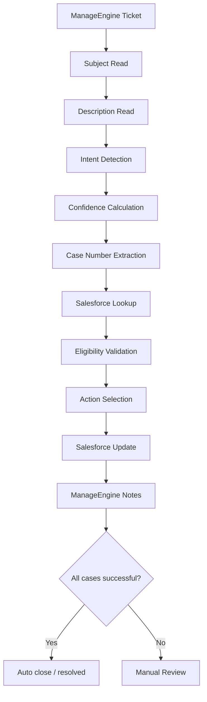

# BOT FLOW AND BUSINESS RULES

Source-only analysis based on the repository code. This document does not assume runtime logs or operational behavior not visible in source.

## 1) High-Level Architecture

### Entry point and lifecycle

The automation is launched from the Python entry point in [src/sr_automation/main.py](../src/sr_automation/main.py#L1860-L1888), which parses `--config` and repeatedly runs `run_cycle()` when `--watch` is enabled.

The actual ticket-processing loop is in [src/sr_automation/main.py](../src/sr_automation/main.py#L963-L1840). The cycle does the following:

1. Load settings from config YAML and environment variables.
2. Fetch open ManageEngine tickets.
3. Filter on group, template, and status.
4. Safety-filter tickets.
5. Parse the ticket subject and description.
6. Extract case numbers.
7. Query Salesforce for case records and related tasks.
8. Decide action and eligibility.
9. Patch Salesforce if eligible.
10. Write a summary note to ManageEngine.
11. Optionally close the ticket if configured.

### Main modules

| Function / area | File | Purpose | Evidence |
|---|---|---|---|
| `main()` | [src/sr_automation/main.py](../src/sr_automation/main.py#L1860-L1888) | CLI entry point and watch loop | [main.py](../src/sr_automation/main.py#L1860-L1888) |
| `run_cycle()` | [src/sr_automation/main.py](../src/sr_automation/main.py#L963-L1840) | Main processing loop | [main.py](../src/sr_automation/main.py#L963-L1840) |
| `parse_ticket()` | [src/sr_automation/parser.py](../src/sr_automation/parser.py#L1-L41) | Intent detection and case-number extraction | [parser.py](../src/sr_automation/parser.py#L1-L41) |
| `decide()` | [src/sr_automation/rules.py](../src/sr_automation/rules.py#L8-L38) | Business eligibility and action rules | [rules.py](../src/sr_automation/rules.py#L8-L38) |
| `load_settings()` | [src/sr_automation/settings.py](../src/sr_automation/settings.py#L87-L171) | Reads env vars and YAML config | [settings.py](../src/sr_automation/settings.py#L87-L171) |
| `ManageEngineClient` | [src/sr_automation/clients.py](../src/sr_automation/clients.py#L6-L108) | ManageEngine API access | [clients.py](../src/sr_automation/clients.py#L6-L108) |
| `SalesforceClient` | [src/sr_automation/clients.py](../src/sr_automation/clients.py#L111-L149) | Salesforce OAuth + SOQL + PATCH | [clients.py](../src/sr_automation/clients.py#L111-L149) |
| `ManageEngineNoteWriter` | [src/sr_automation/manageengine/note_writer.py](../src/sr_automation/manageengine/note_writer.py#L1-L58) | Summary note writes | [note_writer.py](../src/sr_automation/manageengine/note_writer.py#L1-L58) |

### External systems used

- ManageEngine: ticket reads, status update, note write, and closure. Source: [src/sr_automation/clients.py](../src/sr_automation/clients.py#L6-L108), [src/sr_automation/manageengine/note_writer.py](../src/sr_automation/manageengine/note_writer.py#L5-L58).
- Salesforce: OAuth token, SOQL case queries, case updates, task retrieval. Source: [src/sr_automation/clients.py](../src/sr_automation/clients.py#L111-L149).
- Local audit DB: audit repository used to persist idempotency and outcome data. Source: [src/sr_automation/persistence/audit_repository.py](../src/sr_automation/persistence/audit_repository.py).
- YAML config: [config/uat.yaml](../config/uat.yaml#L1-L110)

### Environment variables used

The code explicitly requires or reads these values:

- `MANAGEENGINE_BASE_URL` and `MANAGEENGINE_API_TOKEN` in [src/sr_automation/settings.py](../src/sr_automation/settings.py#L59-L72)
- `MANAGEENGINE_AUTH_HEADER` default `authtoken` in [src/sr_automation/settings.py](../src/sr_automation/settings.py#L94-L98)
- `SALESFORCE_LOGIN_URL`, `SALESFORCE_CLIENT_ID`, `SALESFORCE_CLIENT_SECRET`, `SALESFORCE_API_VERSION` in [src/sr_automation/settings.py](../src/sr_automation/settings.py#L96-L109)
- `DRY_RUN`, `ENABLE_SALESFORCE_WRITES`, `ENABLE_MANAGEENGINE_WRITES`, `MANAGEENGINE_AUTO_CLOSE` in [src/sr_automation/settings.py](../src/sr_automation/settings.py#L109-L145)
- `AUDIT_DB_URL` in [src/sr_automation/main.py](../src/sr_automation/main.py#L972-L976)

No dedicated automation service account name is found in source code; only the token/secret-based configuration is visible. That is effectively “NOT FOUND IN SOURCE CODE”.

---

## 2) End-to-End Flow



### Detailed flow from source

1. `ManageEngineClient.list_open_tickets()` retrieves qualifying open tickets from ManageEngine. Source: [src/sr_automation/clients.py](../src/sr_automation/clients.py#L15-L77).
2. `ManageEngineClient.get_ticket()` fetches the full ticket record. Source: [src/sr_automation/clients.py](../src/sr_automation/clients.py#L79-L80).
3. `parse_ticket()` reads `subject` and `description_html`, normalizes HTML, and identifies actions and case numbers. Source: [src/sr_automation/parser.py](../src/sr_automation/parser.py#L1-L41).
4. `decide()` validates record type, target-status, current status, required activity evidence, and high-confidence reject logic. Source: [src/sr_automation/rules.py](../src/sr_automation/rules.py#L8-L38).
5. `SalesforceClient.cases()` and `.tasks()` query Salesforce for case records and tasks. Source: [src/sr_automation/clients.py](../src/sr_automation/clients.py#L111-L149).
6. `run_cycle()` uses `sf.update_case()` to patch the case status. Source: [src/sr_automation/main.py](../src/sr_automation/main.py#L1348-L1475).
7. A summary note is written with `ManageEngineNoteWriter.post_note()`. Source: [src/sr_automation/manageengine/note_writer.py](../src/sr_automation/manageengine/note_writer.py#L23-L58).
8. Ticket closure is attempted in Stage 4 if `MANAGEENGINE_AUTO_CLOSE` is enabled and all cases are successful. Source: [src/sr_automation/main.py](../src/sr_automation/main.py#L1480-L1840).

---

## 3) Intent Detection

### 3.1 Where intent is determined

Intent detection happens in `parse_ticket()` in [src/sr_automation/parser.py](../src/sr_automation/parser.py#L1-L41).

The logic:

- It normalizes subject and description HTML.
- It evaluates action patterns with `_actions()`.
- It checks negation patterns.
- It resolves action with subject vs description precedence.
- It sets a `confidence` value: `HIGH`, `MEDIUM`, or `LOW`.

### 3.2 Cancel keywords

Source: [src/sr_automation/parser.py](../src/sr_automation/parser.py#L5-L17)

```python
"CANCEL": (
    r"\bcancel\b", r"\bcancelled\b", r"\bcanceled\b",
    r"\bcancellation\b", r"\bcancelling\b", r"\bcanceling\b"
)
```

Also recognized in the script copy at [scripts/parse_manageengine_ticket.py](../scripts/parse_manageengine_ticket.py#L13-L24):

```python
r"\bcancel\b", r"\bcancelled\b", r"\bcanceled\b",
r"\bcancellation\b", r"\bcancellations\b", r"\bto be cancelled\b",
```

### 3.3 Close keywords

Source: [src/sr_automation/parser.py](../src/sr_automation/parser.py#L5-L29)

```python
"CLOSE": (r"\bclose\b", r"\bclosed\b", r"\bclosure\b", r"\bclosing\b")
```

Also seen in the script copy at [scripts/parse_manageengine_ticket.py](../scripts/parse_manageengine_ticket.py#L26-L34).

### 3.4 Reject keywords

Source: [src/sr_automation/parser.py](../src/sr_automation/parser.py#L5-L17)

```python
"REJECT": (r"\breject\b", r"\brejected\b", r"\brejection\b", r"\brejecting\b")
```

### 3.5 Negation / mixed-signal handling

The bot explicitly checks negated phrases such as:

- `do not cancel`
- `don't cancel`
- `not to cancel`
- `do not reject`
- `do not close`

Evidence: [src/sr_automation/parser.py](../src/sr_automation/parser.py#L18-L29).

If negation or mixed positive/negative actions are found, the parser returns `CONFLICT` with low confidence: [src/sr_automation/parser.py](../src/sr_automation/parser.py#L33-L41).

### 3.6 Subject vs description matching logic

This is the exact precedence:

- If description contains one action and subject matches the same action: `HIGH`
- If description contains one action and subject does not match: `MEDIUM`
- If subject contains one action only: `LOW`
- If both subject and description have conflicting or multiple actions: `CONFLICT`

Evidence: [src/sr_automation/parser.py](../src/sr_automation/parser.py#L33-L41).

### 3.7 Phrase matching and weighting

There is no fuzzy matching library or ML model in this project. The actual implementation is plain regex word-boundary matching (`\b`) and action precedence logic.

The weight is effectively:

- `HIGH` = same action found in subject and description
- `MEDIUM` = action found only in description
- `LOW` = action found only in subject or no action match
- `CONFLICT` = multi-action or negation conflict

The code defines that directly in [src/sr_automation/parser.py](../src/sr_automation/parser.py#L33-L41).

---

## 4) Confidence Scoring

### 4.1 Where confidence is calculated

The confidence values are assigned in `parse_ticket()` in [src/sr_automation/parser.py](../src/sr_automation/parser.py#L33-L41).

The result is carried in the `ParseResult.confidence` field defined in [src/sr_automation/models.py](../src/sr_automation/models.py#L5-L16).

### 4.2 `require_high_confidence_intent`

The setting is loaded in [src/sr_automation/settings.py](../src/sr_automation/settings.py#L87-L145), where a default is set from YAML and environment rules.

The actual evaluation occurs in [src/sr_automation/rules.py](../src/sr_automation/rules.py#L8-L38):

```python
reject_requires_task = bool(s.activity_requirements.get("require_closed_rejection_activity", True))
require_high_confidence = bool(s.activity_requirements.get("require_high_confidence_intent", True))
...
elif parsed.action=="REJECT" and require_high_confidence and str(parsed.confidence or "").upper() != "HIGH":
    outcome,reason="CONFIRMATION_REQUIRED","Reject requires high-confidence intent"
```

### 4.3 Thresholds and action behavior

The bot does not use a numeric score. It uses categorical confidence:

- `HIGH` if subject and description both agree
- `MEDIUM` if only the description indicates the action
- `LOW` if only the subject indicates the action, or no action was found
- `CONFLICT` if there are mixed actions or negations

Further gating in [src/sr_automation/rules.py](../src/sr_automation/rules.py#L8-L38):

- `if parsed.action in {"UNKNOWN","CONFLICT"} or parsed.confidence == "LOW":` -> `MANUAL_REVIEW`
- `REJECT` requires `HIGH` confidence when `require_high_confidence_intent` is enabled
- `CANCEL` and `CLOSE` do not require high confidence at the same gate. They only check open-task activity later in the same function.

### 4.4 Answers to the specific questions

- Does Close require high confidence? No, not by this code path. `CLOSE` is only checked for open activities in [src/sr_automation/rules.py](../src/sr_automation/rules.py#L31-L36).
- Does Cancel require high confidence? No. `CANCEL` is not gated by confidence in `decide()`; it only checks `open_count` and status eligibility. Source: [src/sr_automation/rules.py](../src/sr_automation/rules.py#L31-L36).
- Does Reject require high confidence? Yes, if `require_high_confidence_intent` is enabled; source: [src/sr_automation/rules.py](../src/sr_automation/rules.py#L12-L18) and [src/sr_automation/settings.py](../src/sr_automation/settings.py#L91-L101).
- Are different rules used for different actions? Yes. The decision logic branches by action in [src/sr_automation/rules.py](../src/sr_automation/rules.py#L20-L37):
  - `REJECT` has confidence gate and task-evidence check
  - `CANCEL` and `CLOSE` check open activities
  - all actions validate record type and current status

### 4.5 Why a ticket becomes auto-approved or manual review

A case becomes `WOULD_UPDATE` when it passes the action-specific eligibility checks in [src/sr_automation/rules.py](../src/sr_automation/rules.py#L20-L37).

A case becomes `MANUAL_REVIEW` earlier when:

- unknown or conflicting action
- low confidence
- excluded record type
- invalid current status
- missing reject evidence
- open tasks for `CANCEL` or `CLOSE`

Specific logic is in [src/sr_automation/rules.py](../src/sr_automation/rules.py#L8-L38).

---

## 5) Case Number Extraction

### 5.1 Exact extraction logic

The actual extraction regex is in [src/sr_automation/parser.py](../src/sr_automation/parser.py#L1-L5):

```python
CASE_PATTERN = re.compile(r"(?<!\d)\d{4,8}(?!\d)")
```

It is used here:

```python
cases = list(dict.fromkeys(CASE_PATTERN.findall(subject + "\n" + description)))
```

Source: [src/sr_automation/parser.py](../src/sr_automation/parser.py#L33-L41).

### 5.2 What values it captures

This regex captures any contiguous 4-to-8 digit sequence not adjacent to another digit.

Examples from this law:

- `23425715` -> captured
- `SR23425715` -> captured as `23425715`
- `Case 23425715` -> captured as `23425715`
- `SR 23425715` -> captured as `23425715`

The code does not require a `Case`, `SR`, or `case number` prefix. It only requires the digits to be surrounded by a non-digit boundary.

### 5.3 Can dates be extracted accidentally?

Yes. This is a real false positive risk.

Example: `28/04/2026`

It contains `2026`, which is a 4-digit number and is not adjacent to another digit. The regex will match it because the preceding character is `/` and the following end-of-string is not a digit.

The exact issue is visible in the regex itself: `\d{4,8}` allows 4-digit years, and the pattern is not restricted to SR/Case values.

### 5.4 Why `2026` is extracted

This is the path that allows it:

- [src/sr_automation/parser.py](../src/sr_automation/parser.py#L1-L5): regex allows 4-digit numbers
- [src/sr_automation/parser.py](../src/sr_automation/parser.py#L34-L41): the full subject + description is scanned without a case-number context check
- The regex returns all candidates, not only Salesforce Case IDs

### 5.5 False positive risk and recommendations

The risk is real because the code checks merely for `\d{4,8}` anywhere, not case-specific semantics. Recommendations from source-only analysis:

1. Restrict extraction to digits adjacent to `case`, `sr`, `case number`, or a known SR prefix.
2. Require 8 digits for Salesforce case numbers in the final match.
3. Reject dates by checking month/day ranges and separators such as `/` and `-`.
4. Use a post-filter that excludes date-like patterns before accepting case numbers.

The current source does not do any of that. The simplest evidence is the regex itself in [src/sr_automation/parser.py](../src/sr_automation/parser.py#L1-L5).

---

## 6) Eligibility Rules and Outcomes

These outcomes are produced in [src/sr_automation/rules.py](../src/sr_automation/rules.py#L8-L38) and then handled in the main control loop at [src/sr_automation/main.py](../src/sr_automation/main.py#L1095-L1463).

### Outcome matrix

| Outcome | Meaning | Source/
|---|---|---|
| `CASE_NOT_FOUND` | Case not found in Salesforce | [rules.py](../src/sr_automation/rules.py#L14-L18), [main.py](../src/sr_automation/main.py#L1244-L1255) |
| `WOULD_UPDATE` | Eligible for dry-run or live patch | [rules.py](../src/sr_automation/rules.py#L31-L38), [main.py](../src/sr_automation/main.py#L1194-L1239) |
| `INVALID_CURRENT_STATUS` | Current Salesforce status not eligible | [rules.py](../src/sr_automation/rules.py#L25-L30), [main.py](../src/sr_automation/main.py#L1271-L1285) |
| `SUCCESS` | Case status updated and verified | [main.py](../src/sr_automation/main.py#L1393-L1475) |
| `MANUAL_REVIEW` | Case should not be auto-processed | [rules.py](../src/sr_automation/rules.py#L8-L13), [main.py](../src/sr_automation/main.py#L1089-L1098) |
| `FAILED` | Update attempt failed or verification failed | [main.py](../src/sr_automation/main.py#L1256-L1376) |

### Business and technical meaning by outcome

#### `CASE_NOT_FOUND`
- Business meaning: the indicated case number cannot be matched to a Salesforce Case record; no automation should update anything.
- Technical logic: `cases.get(number)` returns `None` and the code records `CASE_NOT_FOUND`.
- Scope: [src/sr_automation/rules.py](../src/sr_automation/rules.py#L12-L18)

#### `WOULD_UPDATE`
- Business meaning: the case is eligible to be updated to the action target status.
- Technical logic: the code reaches the final `else` branch in `decide()` after status, record type, task checks, and action conditions pass.
- Scope: [src/sr_automation/rules.py](../src/sr_automation/rules.py#L20-L38)

#### `INVALID_CURRENT_STATUS`
- Business meaning: the case is not in an allowed status for the action.
- Technical logic: `status not in s.eligible_statuses.get(parsed.action, set())`.
- Scope: [src/sr_automation/rules.py](../src/sr_automation/rules.py#L25-L30)

#### `SUCCESS`
- Business meaning: the Salesforce update succeeded and the state is verified.
- Technical logic: the bot re-reads the case and checks `post.get("Status") == target` before recording `SUCCESS`.
- Scope: [src/sr_automation/main.py](../src/sr_automation/main.py#L1393-L1475)

#### `MANUAL_REVIEW`
- Business meaning: human intervention is needed because the request is ambiguous, low confidence, conflicting, or blocked by other rules.
- Technical logic: `if parsed.action in {"UNKNOWN","CONFLICT"} or parsed.confidence == "LOW"` early return.
- Scope: [src/sr_automation/rules.py](../src/sr_automation/rules.py#L8-L13)

#### `FAILED`
- Business meaning: the update did not complete or could not be verified.
- Technical logic: capture includes `CASE_NOT_FOUND_ON_REREAD`, `STALE_RECORD`, `UPDATE_RESULT_UNKNOWN`, `VERIFICATION_FAILED`, and HTTP failure cases.
- Scope: [src/sr_automation/main.py](../src/sr_automation/main.py#L1256-L1376)

---

## 7) Salesforce Logic

### 7.1 Lookup flow

Salesforce lookup is implemented in `SalesforceClient`:

- `authenticate()` obtains OAuth token from Salesforce using client credentials: [src/sr_automation/clients.py](../src/sr_automation/clients.py#L111-L120)
- `cases(numbers)` runs a `Case` SOQL query by `CaseNumber IN (...)`: [src/sr_automation/clients.py](../src/sr_automation/clients.py#L121-L130)
- `tasks(case_ids)` retrieves related `Task` records: [src/sr_automation/clients.py](../src/sr_automation/clients.py#L141-L149)

The main loop calls those methods in [src/sr_automation/main.py](../src/sr_automation/main.py#L1091-L1102).

### 7.2 Validation flow

The bot revalidates before every patch:

- excluded record type check: [src/sr_automation/main.py](../src/sr_automation/main.py#L1271-L1275)
- status eligibility check: [src/sr_automation/main.py](../src/sr_automation/main.py#L1278-L1285)
- stale record check by `LastModifiedDate`: [src/sr_automation/main.py](../src/sr_automation/main.py#L1248-L1269)
- open-task check for `CANCEL` and `CLOSE`: [src/sr_automation/main.py](../src/sr_automation/main.py#L1304-L1311)
- reject-evidence check for `REJECT`: [src/sr_automation/main.py](../src/sr_automation/main.py#L1312-L1319)

### 7.3 Update flow

The patch is made in `sf.update_case(case_id, fields)` after building a target status payload. Source: [src/sr_automation/clients.py](../src/sr_automation/clients.py#L139-L149) and [src/sr_automation/main.py](../src/sr_automation/main.py#L1320-L1392).

### 7.4 Status transitions configured by action

These are defined in [config/uat.yaml](../config/uat.yaml#L41-L89):

- Cancel -> `Cancelled`
- Reject -> `Rejected`
- Close -> `Closed`

Status eligibility by action is in the same YAML file:

- Cancel: New, Submitted
- Reject: New, Submitted
- Close: New, Submitted, Working, Waiting

This is mirrored into the `Settings` object through [src/sr_automation/settings.py](../src/sr_automation/settings.py#L89-L145).

### 7.5 Status examples

Examples from config: `New -> Cancelled`, `Submitted -> Cancelled`, `New -> Rejected`, `Submitted -> Rejected`, `Working -> Closed`, `Waiting -> Closed`.

This is not a generic workflow; it is a direct status map from configuration, and the rules enforce it.

---

## 8) Simple summary

The bot is a rule-based automation that:

- reads ManageEngine tickets,
- parses the intent from subject + description,
- extracts case numbers using regex,
- queries Salesforce,
- checks record status and activity constraints,
- updates the case to the target status,
- records a summary note back to ManageEngine,
- and optionally closes the ticket when the environment is configured to do so.

This is source-grounded in [src/sr_automation/main.py](../src/sr_automation/main.py#L963-L1840), [src/sr_automation/parser.py](../src/sr_automation/parser.py#L1-L41), and [src/sr_automation/rules.py](../src/sr_automation/rules.py#L8-L38).
